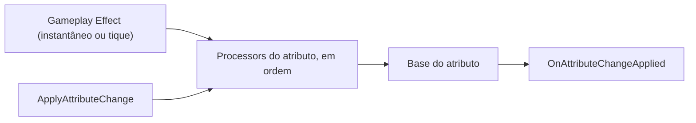

# Dano, escudo e morte {#dano-escudo-e-morte}

Esta página ensina a mudar o dano e a cura antes que cheguem ao atributo. Cada atributo pode ter uma lista de processadores que leem a alteração pedida (o golpe de -30, a cura de +10) e decidem quanto dela vale: reduzir, aumentar ou anular. Use quando o mesmo atributo precisa reagir sempre do mesmo jeito, venha a alteração de qualquer efeito.

Módulo: assembly `SpellBook.GAS`, o mesmo do [sistema de habilidades](gas.md).

## Como funciona {#como-funciona}

Toda mudança na base de um atributo passa pela lista de processadores da `AttributeDefinition` desse atributo. Isso vale para o efeito instantâneo, para o tique de um efeito periódico e para a alteração feita pelo código com `ApplyAttributeChange`.

O primeiro processador recebe a variação pedida. Cada um muda a variação e passa a seguinte adiante, na ordem da lista. O que sobra no fim é a variação final, e a base muda por ela, dentro do mínimo e do máximo do atributo. Variação final zero deixa a base como estava.

Os modificadores de efeitos com duração ou infinitos não passam pelos processadores. Eles não mudam a base: somam ao valor atual enquanto o efeito dura.

### Redirecionar para outro atributo {#redirecionar}

Um processador pode mandar parte da alteração para outro atributo do mesmo dono, como um escudo que absorve o golpe antes da vida. A parte redirecionada passa pelos processadores do atributo de destino e é aplicada antes da alteração original. Assim o escudo chega ao mínimo antes da vida mudar.

Cada alteração gera o seu relatório, na ordem em que é aplicada: primeiro as redirecionadas, depois a original. Um atributo que já está na cadeia (a vida manda ao escudo, e o escudo devolve à vida) recebe a parte dele direto, sem rodar os processadores de novo. O mesmo vale a partir do nono atributo da cadeia. Nos dois casos, o Console mostra um aviso, uma vez por atributo.


*Os processadores do `AttributeDefinition` ficam entre o efeito (ou o código) e a base do atributo, e cada alteração termina num relatório.*

## AttributeChangeProcessor {#attributechangeprocessor}

Um passo da lista de processadores de um atributo. Fica no asset do atributo, então todo dono desse atributo usa a mesma lista.

### Campos do Inspector {#attributechangeprocessor-campos}

- `Processors` (na seção `Damage` da `AttributeDefinition`): a lista de passos, executada de cima para baixo. Adicione um item e escolha o tipo no seletor. Um item vazio é pulado.

A ordem muda o resultado. Com um processador que soma 10 e outro que corta pela metade, um golpe de -20 vira -5 com a soma antes (`(-20 + 10) × 0,5`) e vira 0 com o corte antes (`-20 × 0,5 + 10`). A mesma lista dá sempre o mesmo resultado.

## Tipos de dano {#tipos-de-dano}

O tipo de dano é uma tag no `GameplayEffect`. No campo `Damage Tags` (seção `Gameplay Tags` do efeito), escolha uma ou mais tags, como `Dano.Fogo` e `Dano.Magico`. Os processadores que filtram por tipo comparam essas tags pela hierarquia: um filtro `Dano` casa com `Dano.Fogo` e com `Dano.Magico`.

Uma linha vazia em `Damage Tags` não casa com nenhum filtro e não lança erro.

## Prontos para usar {#prontos}

O pacote traz três processadores no grupo **Dano** do seletor da lista `Processors`.

### ReduceByAttribute {#reducebyattribute}

Reduz a alteração pelo valor atual de um atributo do mesmo dono, como uma resistência ou uma armadura. Se o dono não tem esse atributo, a alteração passa inteira.

- `Source Attribute`: o atributo do dono que dá a redução.
- `Mode`: escolha entre
    - `Percent`: reduz a alteração pelo valor, de 0 a 1. Com 0,5, um golpe de -100 vira -50. Valores fora de 0 a 1 contam como 0 ou 1.
    - `Flat`: tira o valor da alteração, até zerá-la. Com 15, um golpe de -40 vira -25 e um de -10 vira 0, nunca uma cura.
- `Damage Tags`: os tipos de dano reduzidos. Vazio reduz qualquer alteração, inclusive as feitas pelo código.
- `Only Negative`: ligado, só o dano é reduzido e as curas passam inteiras.

Com uma `Resistência ao fogo` de 0,5 e `Damage Tags` em `Dano.Fogo`, um efeito de fogo de 100 tira 50 da vida e um de veneno de 100 tira 100.

### ImmuneToTags {#immunetotags}

Anula a alteração deste atributo quando o efeito tem um dos tipos de dano da lista. O resto do efeito vale: um efeito de fogo que também concede `Estado.Queimando` e tira mana continua fazendo isso num alvo imune a fogo.

- `Damage Tags`: os tipos de dano anulados. Vazio não anula nada.

### AbsorbWithAttribute {#absorbwithattribute}

Gasta um atributo de escudo do mesmo dono antes do atributo que recebe o dano. O escudo absorve o que puder, até chegar ao mínimo dele, e o resto do golpe segue para o atributo. A parte do escudo é uma [alteração redirecionada](#redirecionar): ela é aplicada antes, então o escudo chega ao mínimo antes da vida. Curas passam inteiras, e um dono sem o escudo recebe o golpe inteiro.

- `Shield`: o atributo do dono que absorve o dano.
- `Damage Tags`: os tipos de dano absorvidos. Vazio absorve qualquer dano, inclusive o feito pelo código.
- `Fraction`: a parte do golpe que o escudo pode absorver, de 0 a 1. Com 0,5, o escudo pega no máximo metade e a outra metade vai ao atributo.

Para montar o escudo, crie um atributo `Escudo` com mínimo 0, ponha-o no `AttributeSet` do personagem e adicione um `AbsorbWithAttribute` com `Shield` em `Escudo` à lista `Processors` da `Vida`. Com `Escudo` 50 e `Vida` 100:

| Golpe | `Escudo` depois | `Vida` depois |
|---|---|---|
| -30 | 20 | 100 |
| -30 (com `Escudo` 20) | 0 | 90 |
| -30 (com `Escudo` 0) | 0 | 70 |

Quando o `Escudo` chega a 0, o `OnDepleted` dele dispara uma vez, antes de qualquer `OnDepleted` da `Vida` no mesmo golpe.

## Pelo código {#codigo}

Para mudar um atributo pelo código e passar pelos processadores, chame `ApplyAttributeChange` no `AbilitySystemComponent`. O retorno é quanto a base mudou de fato, já com os limites:

```csharp
float aplicado = asc.ApplyAttributeChange(vida, -25f);
```

Sem contexto e sem efeito, o processador recebe um `EffectContext` vazio e `Effect` nulo. Para dizer quem causou a alteração, passe o contexto e o efeito:

```csharp
asc.ApplyAttributeChange(vida, -25f, in contexto, efeito);
```

Cada alteração gera um relatório no evento `OnAttributeChangeApplied`, depois do `OnValueChanged` do atributo. A alteração anulada também gera relatório, sem mudar o valor:

```csharp
asc.OnAttributeChangeApplied += (in AttributeChangeReport relatorio) =>
{
    Debug.Log($"{relatorio.Attribute.name}: pedido {relatorio.Requested}, final {relatorio.Final}, aplicado {relatorio.Applied}");
};
```

O `AttributeChangeReport` tem `Attribute`, `Requested` (a variação pedida), `Final` (depois dos processadores), `Applied` (o que a base mudou, depois do mínimo e do máximo), `Effect` (nulo numa alteração por código), `Context` e `RedirectedFrom` (o atributo que redirecionou a alteração, nulo na original). Um relatório `default` tem `IsValid` falso.

Para saber, dentro de um ouvinte de `OnValueChanged`, que efeito causou a mudança, chame `TryGetActiveChangeSource` no `AbilitySystemComponent`. Ele devolve verdadeiro, com o efeito e o contexto, só durante a aplicação de uma alteração pelo pipeline. Se o ouvinte aplicar outra alteração, ela tem a própria origem até terminar, e depois a de fora volta:

```csharp
if (asc.TryGetActiveChangeSource(out GameplayEffect efeito, out EffectContext contexto))
{
    string origem = efeito != null ? efeito.name : "código";
    Debug.Log($"{origem}, nível {contexto.Level}");
}
```

Com a lista `Processors` vazia, a base recebe a variação pedida direto, sem passo extra.

## Criar o seu {#criar-o-seu}

Escreva um processador quando a regra vale para todo dano ou cura de um atributo. Herde de `AttributeChangeProcessor`, marque a classe com `[Serializable]` e mude o `Delta`:

```csharp
using System;
using SpellBook.GAS.Attributes;
using SpellBook.GAS.Effects;

[Serializable]
public sealed class CortaPelaMetade : AttributeChangeProcessor
{
    public override void Process(ref AttributeChange change, in EffectContext context, AttributeChangeQueue queue)
    {
        if (change.Delta < 0f) change.Delta *= 0.5f; // só o dano
    }
}
```

A classe aparece no seletor da lista `Processors`. `change.Requested` guarda a variação pedida, e `queue.TryGetState` lê outro atributo do mesmo dono, como uma resistência. Para passar parte da alteração a outro atributo, chame `queue.Redirect` e tire essa parte do `Delta`:

```csharp
float parte = change.Delta * 0.5f;
queue.Redirect(escudo, parte);
change.Delta -= parte;
```

Confira se `change.Effect` e `context.Instigator` são nulos antes de usá-los, porque uma alteração por código chega sem eles.

## Veja também {#veja-tambem}

- [Sistema de habilidades](gas.md): atributos, efeitos e o `AbilitySystemComponent`.
- [Validador](../ferramentas/validador.md): confere os assets do projeto.
