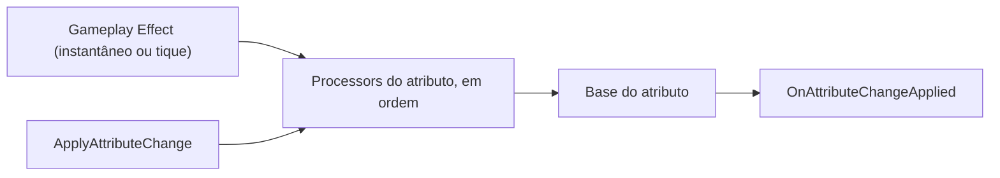

# Dano, escudo e morte {#dano-escudo-e-morte}

Esta página ensina a mudar o dano e a cura antes que cheguem ao atributo. Cada atributo pode ter uma lista de processadores que leem a alteração pedida (o golpe de -30, a cura de +10) e decidem quanto dela vale: reduzir, aumentar ou anular. Use quando o mesmo atributo precisa reagir sempre do mesmo jeito, venha a alteração de qualquer efeito.

Módulo: assembly `SpellBook.GAS`, o mesmo do [sistema de habilidades](gas.md).

## Como funciona {#como-funciona}

Toda mudança na base de um atributo passa pela lista de processadores da `AttributeDefinition` desse atributo. Isso vale para o efeito instantâneo, para o tique de um efeito periódico e para a alteração feita pelo código com `ApplyAttributeChange`.

O primeiro processador recebe a variação pedida. Cada um muda a variação e passa a seguinte adiante, na ordem da lista. O que sobra no fim é a variação final, e a base muda por ela, dentro do mínimo e do máximo do atributo. Variação final zero deixa a base como estava.

Os modificadores de efeitos com duração ou infinitos não passam pelos processadores. Eles não mudam a base: somam ao valor atual enquanto o efeito dura.


*Os processadores do `AttributeDefinition` ficam entre o efeito (ou o código) e a base do atributo, e cada alteração termina num relatório.*

## AttributeChangeProcessor {#attributechangeprocessor}

Um passo da lista de processadores de um atributo. Fica no asset do atributo, então todo dono desse atributo usa a mesma lista.

### Campos do Inspector {#attributechangeprocessor-campos}

- `Processors` (na seção `Damage` da `AttributeDefinition`): a lista de passos, executada de cima para baixo. Adicione um item e escolha o tipo no seletor. Um item vazio é pulado.

A ordem muda o resultado. Com um processador que soma 10 e outro que corta pela metade, um golpe de -20 vira -5 com a soma antes (`(-20 + 10) × 0,5`) e vira 0 com o corte antes (`-20 × 0,5 + 10`). A mesma lista dá sempre o mesmo resultado.

## Pelo código {#codigo}

Para mudar um atributo pelo código e passar pelos processadores, chame `ApplyAttributeChange` no `AbilitySystemComponent`. O retorno é quanto a base mudou de fato, já com os limites:

```csharp
float aplicado = asc.ApplyAttributeChange(vida, -25f);
```

Sem contexto e sem efeito, o processador recebe um `EffectContext` vazio e `Effect` nulo. Para dizer quem causou a alteração, passe o contexto e o efeito:

```csharp
asc.ApplyAttributeChange(vida, -25f, in contexto, efeito);
```

Cada alteração gera um relatório no evento `OnAttributeChangeApplied`, depois do `OnValueChanged` do atributo. A alteração anulada também gera relatório, sem mudar o valor:

```csharp
asc.OnAttributeChangeApplied += (in AttributeChangeReport relatorio) =>
{
    Debug.Log($"{relatorio.Attribute.name}: pedido {relatorio.Requested}, final {relatorio.Final}, aplicado {relatorio.Applied}");
};
```

O `AttributeChangeReport` tem `Attribute`, `Requested` (a variação pedida), `Final` (depois dos processadores), `Applied` (o que a base mudou, depois do mínimo e do máximo), `Effect` (nulo numa alteração por código) e `Context`. Um relatório `default` tem `IsValid` falso.

Com a lista `Processors` vazia, a base recebe a variação pedida direto, sem passo extra.

## Criar o seu {#criar-o-seu}

Escreva um processador quando a regra vale para todo dano ou cura de um atributo. Herde de `AttributeChangeProcessor`, marque a classe com `[Serializable]` e mude o `Delta`:

```csharp
using System;
using SpellBook.GAS.Attributes;
using SpellBook.GAS.Effects;

[Serializable]
public sealed class CortaPelaMetade : AttributeChangeProcessor
{
    public override void Process(ref AttributeChange change, in EffectContext context, AttributeChangeQueue queue)
    {
        if (change.Delta < 0f) change.Delta *= 0.5f; // só o dano
    }
}
```

A classe aparece no seletor da lista `Processors`. `change.Requested` guarda a variação pedida, e `queue.TryGetState` lê outro atributo do mesmo dono, como uma resistência. Confira se `change.Effect` e `context.Instigator` são nulos antes de usá-los, porque uma alteração por código chega sem eles.

## Veja também {#veja-tambem}

- [Sistema de habilidades](gas.md): atributos, efeitos e o `AbilitySystemComponent`.
- [Validador](../ferramentas/validador.md): confere os assets do projeto.
